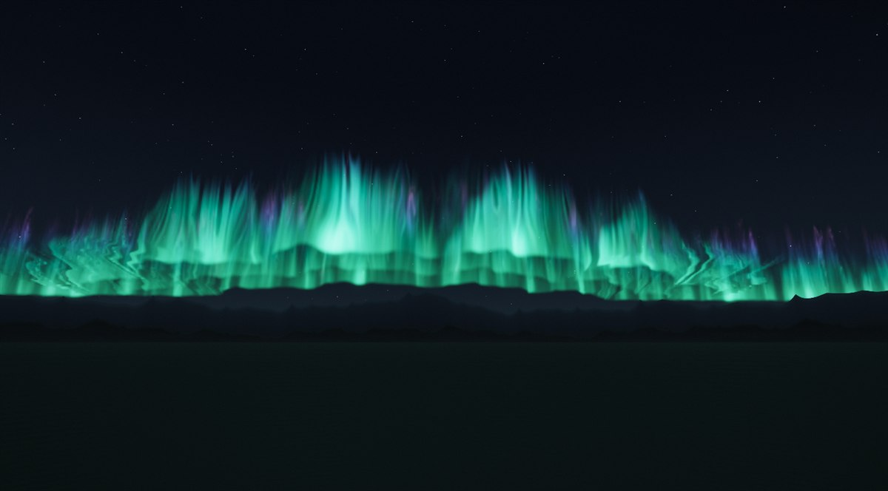

# Aurora Borealis — real-time WebGL 2 simulation

A ground-level view of the northern lights, rendered entirely in a WebGL 2
fragment shader. There are no image textures, models or video: the curtains,
stars, Milky Way, mountains and ground are generated procedurally every frame.



## Run it

The page is a static site with classic `<script>` tags, so there is no build
step.

- **Simplest:** open `index.html` in a browser. Everything is local; nothing is
  fetched from the network.
- **Or serve the folder** (recommended if the browser is strict about `file://`):

  ```sh
  python -m http.server 8123 --bind 127.0.0.1
  # then open http://127.0.0.1:8123/
  ```

Requires a WebGL 2 browser with 3D texture support (current Chrome, Edge,
Firefox and Safari all qualify). HDR rendering uses `EXT_color_buffer_float`
when available and falls back to 8-bit targets automatically.

## What the simulation models

The visual state is driven by a small space-weather model in `js/physics.js`
rather than by hand-animated brightness curves.

```
solar wind (speed, density, IMF Bz)
        │
        ▼
dayside reconnection coupling
        │
        ▼
magnetospheric energy storage
        │
        ▼
substorm onset ──► particle precipitation ──► atmospheric emission
```

- **Solar wind** speed, density and `Bz` vary on several slow sine periods.
  Southward `Bz` and high speed raise the coupling proxy.
- **Substorm cycle**: `QUIET → GROWTH → EXPANSION → RECOVERY`.
  Energy builds during growth, releases quickly at expansion onset, then decays
  through recovery. The HUD shows the current phase. A first substorm begins
  about 26 seconds after load; later ones are scheduled by the model.
- **Activity and surge** are the only values the renderer reads. They modulate
  emission brightness, filament contrast, palette warmth and the bloom that the
  bright curtains receive.
- **Emission colours** follow the dominant auroral lines: the 557.7 nm oxygen
  green at the lower border, 630.0 nm oxygen red at high altitude, and
  nitrogen blue/violet where energetic precipitation reaches the bottom of the
  curtain. Colour is therefore a function of altitude, ray energy and activity,
  not an arbitrary gradient.
- **Geometry**: the aurora is a set of near-vertical, east–west aligned sheets
  between roughly 82 and 385 km altitude. Their lower edge forms the bright arc
  near the horizon; the sheets lean and fold to imitate magnetic field-aligned
  curtains.

The result is physically ordered, but it is an artistic model, not a forecast
or a magnetohydrodynamic simulation.

## Rendering pipeline

All passes use one fullscreen triangle and no per-frame allocations.

| # | Pass | Target | What it does |
|---|------|--------|--------------|
| 1 | Aurora volume | 0.34–0.9× canvas, `RGBA16F` | Solves each camera ray against up to four warped curtain sheets, composites them front-to-back. |
| 2 | Bloom extract | 1/2 resolution | Thresholds the aurora with a soft knee so only bright curtain cores bloom. |
| 3 | Separable blur | 1/2 and 1/4 resolution | Two Gaussian H/V pairs at different scales. |
| 4 | Scene composite | canvas | Procedural sky, stars, Milky Way, aurora, two-scale bloom, mountains, ground, ACES tone mapping, grain, vignette. |

Only the aurora feeds bloom, so stars and the terrain silhouette stay clean
while bright curtains gain a soft atmospheric halo.

### The curtain model

A naive raymarch through a thin sheet aliases badly: the fine ray structure
changes between samples, producing salt-and-pepper pixels. The renderer instead
solves for the ray's intersection with each sheet:

1. Define the sheet surface depth
   `z(x, y, t) = z0 + bow·(x/z0)² + fold(x, y, t) + lean(y)`.
2. Iterate `t ← (z(x(t), y(t), t) − camZ) / rd.z` three times. This converges on
   the point where the camera ray crosses the warped sheet.
3. Evaluate all curtain structure once at that point: large-scale flow,
   folds, arc-scale envelope, vertical field-aligned rays, altitude profile.
4. Multiply by the analytic line integral of the sheet's Gaussian
   cross-section:

   ```
   ∫ ρ(s) ds = √π · width / |sRate|
   ```

   where `sRate = rd.z − (dz/dy) · rd.y / altSpan` accounts for the ray crossing
   the sheet at a slant.
5. Sort the four sheets by distance and composite front to back with
   `T *= exp(−τ·absorb)`. This gives overlapping layers real depth while
   remaining cheap.

Because each sheet is integrated analytically, the image is essentially free of
step aliasing. The quality setting therefore controls detail (`uSteps`) and the
sheet width, not a sample loop.

### Procedural noise

`js/noise.js` builds a tileable 64³ RGBA8 value-noise volume on the CPU once at
startup. Each channel has its own lattice period (`4, 8, 16, 8`), so a single
trilinear fetch returns large, medium and fine scales at once. The texture is
mipmapped and repeats on all axes. Time animation scrolls the W coordinate, and
domain warping uses one channel to displace the sampling of another.

The same volume is reused by the scene pass for the Milky Way dust, mountain
facets and ground snow.

### Sky, terrain and grade

- Stars are hashed per direction cell in two layers with different density and
  size; they twinkle slowly and sit behind the additive aurora.
- The Milky Way is a Gaussian band around a fixed axis, modulated by noise dust.
- Mountains use ridged azimuthal noise at two frequencies, converted to an
  elevation silhouette with anti-aliased edges, plus a faint aurora-lit rim.
- The ground is a dark snow field with noise mottling and a low green
  reflection near the horizon.
- The final image is exposed, ACES tone mapped, lightly graded, converted to
  sRGB, vignetted and given fine grain.

## Controls

| Control | Range | Effect |
|---|---|---|
| Aurora intensity | 0–2 | Global emission multiplier. |
| Turbulence | 0.2–2 | Amplitude and contrast of folds and fine filaments. |
| Curtain density | 0.15–1 | Opacity, sheet absorption and number of active layers (2–4). |
| Emission altitude | 0–1 | Shifts the green/teal/blue/violet/red palette up or down. |
| Simulation speed | 0–3× | Speed of the space-weather clock and curtain flow. |
| Exposure | 0.4–2.2 | Filmic exposure before tone mapping. |
| Trigger substorm | button | Starts a growth phase, or adds a surge to a running substorm. |
| Pause | button | Freezes simulation time (camera drift continues). |
| Auto camera | toggle | Slow cinematic yaw/pitch sway. |
| Reset view | button | Returns to the default framing. |
| Quality | button | Cycles Low → Medium → High → Ultra. |
| Adaptive resolution | toggle | Lowers resolution/detail if FPS drops; restores it when there is headroom. |

Keyboard: `Space` pause, `S` substorm, `R` reset view, `Q` cycle quality,
`H` hide all UI. Drag to look, scroll to zoom, double-click to reset.

## URL parameters

Development and review helpers:

| Parameter | Example | Effect |
|---|---|---|
| `quality` | `?quality=medium` | Start at a named quality tier. |
| `scale` | `?scale=0.6` | Override aurora buffer scale (0.24–1.0). |
| `steps` | `?steps=40` | Override detail level (16–96). |
| `noauto` | `?noauto` | Disable adaptive resolution. |
| `capture` | `?capture=1` | `preserveDrawingBuffer`, for canvas screenshots. |
| `ldr=1` | `?ldr=1` | Force 8-bit targets even when float buffers exist. |

## Tuning

All live defaults and world constants are in `js/config.js`.

### World and camera

| Key | Default | Meaning |
|---|---|---|
| `world.baseAlt` | `82` km | Lower edge of the green emission layer. |
| `world.topAlt` | `252` km | Nominal top of the curtain (far sheets reach higher). |
| `world.nearZ`, `farZ` | `300`, `900` km | Depth range of the auroral slab. |
| `world.halfWidth` | `1700` km | Half extent of the slab across the view. |
| `world.curtainBaseZ` | `430` km | Depth of the first sheet. |
| `world.curtainSpacing` | `125` km | Depth gap between sheets. |
| `camera.pitch` | `0.215` rad | Default elevation above the horizon. |
| `camera.fov` | `61°` | Default vertical field of view. |

### Bloom and quality

| Key | Default | Meaning |
|---|---|---|
| `bloom.threshold` | `0.72` | Linear HDR threshold for bloom extraction. |
| `bloom.knee` | `0.50` | Soft cut width around the threshold. |
| `bloom.strength` | `0.66` | Weight of the 1/2-resolution bloom. |
| `bloom.wideStrength` | `0.36` | Weight of the 1/4-resolution bloom. |
| `quality.low` | `0.34`, `34` | Aurora scale and detail level. |
| `quality.medium` | `0.46`, `46` | |
| `quality.high` | `0.58`, `60` | Default. |
| `quality.ultra` | `0.72`, `76` | |

Each tier also has a `maxScale` used by adaptive quality when there is
performance headroom.

### Shader parameters

The aurora shader (`js/shaders/aurora.js`) receives:

| Uniform | Meaning |
|---|---|
| `uIntensity`, `uTurbulence`, `uDensity` | UI parameters. |
| `uColorBias` | Emission-altitude palette shift. |
| `uActivity`, `uSurge` | Space-weather brightness and substorm envelope. |
| `uSteps` | Detail quality: drives `detail` and sheet width. |
| `uLayers` | Number of active curtain sheets (2–4). |
| `uWidthScale` | Compensates fewer detail levels with slightly wider sheets. |
| `uBaseAlt`, `uAltSpan` | Altitude mapping of the slab. |
| `uBaseZ`, `uSpacing` | Sheet depths. |
| `uNoise` | The 64³ RGBA noise volume. |

Notable constants inside the shader:

- `gainBase = 0.060 · intensity · (0.62 + 0.80·activity + 0.28·surge)` —
  overall emission gain.
- `absorb = 0.014 · (0.35 + 0.9·density)` — per-layer optical depth.
- `foldAmp ≈ 22–52 km` — depth displacement of the curtain folds.
- `bow = 210·(x/z0)²` km — recedes the sheet at the frame edges so the arc
  sweeps up in the middle.
- `lean = v·(17 + 14·noise)` km — height-dependent tilt of the field lines.
- Ray frequency `0.026`, two octaves; arc envelope and lobes are extra
  low-frequency fetches of the same noise volume.
- `emissionColor()` holds the green/teal/blue/violet/red palette.

Scene-side parameters live in `js/shaders/scene.js` (star layers, Milky Way
axis, ridge frequencies `6.0/9.0`, grading); the star tuning and bloom weights
are in `js/config.js`.

## Performance notes

- The aurora volume runs at 34–90 % of canvas resolution. Its detail is soft,
  so this is nearly invisible after upsampling and bloom.
- The canvas is capped at ~3.7 megapixels and DPR 1.75 to bound fill cost.
- Bloom is evaluated at 1/2 and 1/4 resolution.
- The 3D noise texture is mipmapped and generated once; no allocations occur
  per frame.
- Adaptive quality reduces the aurora scale and detail when FPS falls below
  ~47, and recovers when FPS exceeds ~58.
- If `requestAnimationFrame` is throttled to a standstill (some embedded
  panels), a timer-driven fallback keeps the simulation running.

## Files

```
index.html              markup, UI, error overlay
css/style.css           visual design and responsive layout
js/config.js            world, camera, quality, bloom and noise defaults
js/noise.js             tileable 3D value-noise generator
js/physics.js           solar wind → coupling → substorm state machine
js/camera.js            damped look controls and cinematic drift
js/gl.js                programs, render targets, noise texture helpers
js/shaders/common.js    fullscreen triangle, hashes, ACES, sRGB
js/shaders/aurora.js    closest-approach curtain volume
js/shaders/post.js      bloom extract, blur, downsample
js/shaders/scene.js     sky, stars, aurora composite, terrain, grade
js/renderer.js          render pipeline and target management
js/ui.js                DOM controls and keyboard shortcuts
js/main.js              boot, frame loop, adaptive resolution
tools/shot.mjs          headless Chrome screenshot harness (development only)
```

## Development harness

`tools/shot.mjs` drives headless Chrome over the DevTools protocol and saves
either the canvas or the full page. It expects Chrome at
`C:\Program Files\Google\Chrome\Application\chrome.exe`; adjust `chromePath` for
another platform.

```sh
# canvas only
node tools/shot.mjs "http://127.0.0.1:8123/?v=64&quality=high&noauto&capture=1" shot.png 1200

# full page, including the control panel
$env:SHOT_PAGE="1"           # PowerShell
node tools/shot.mjs "http://127.0.0.1:8123/?v=64" page.png 1200
```

Other environment variables: `SHOT_SIZE` (`1200,760`), `SHOT_EVAL` (JavaScript
run before capture), `SHOT_EVAL_WAIT` (ms), `SHOT_EMULATE` (`390x780`, applies
mobile emulation and reloads), `SHOT_DPR`.

The version query string (`?v=64`) is only cache busting and can be omitted in
normal use.
